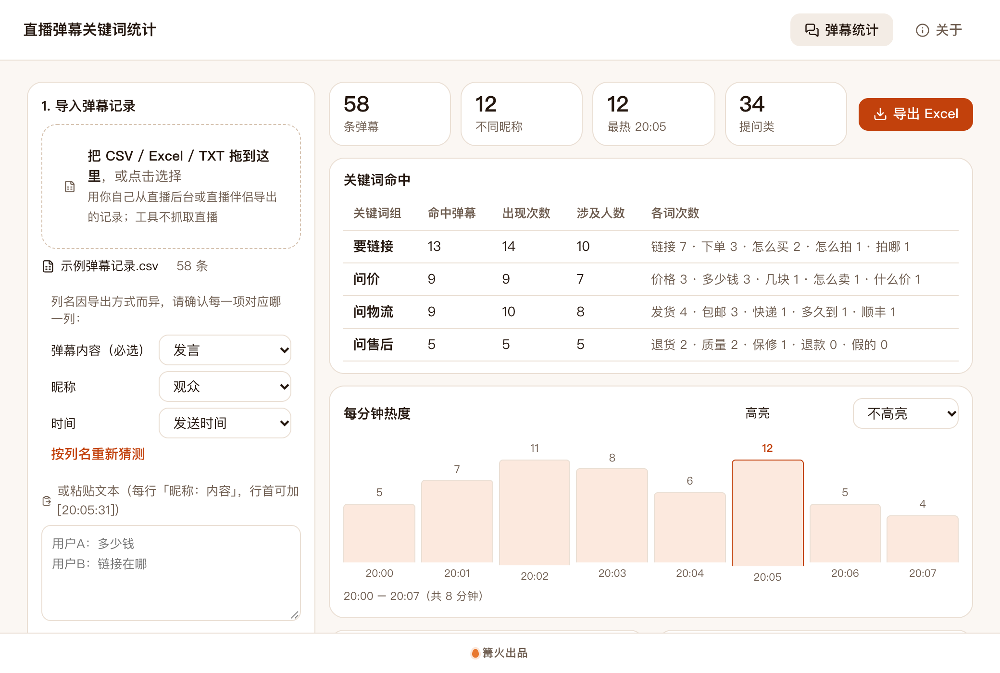

# 直播弹幕关键词统计

> 篝火出品 · 收录于篝火 App 应用区

> [!WARNING]
> 本工具涉及第三方平台的自动化或内容获取，存在账号被限制、违反平台规则或侵权的风险，仅供学习研究。请遵守平台规则与法律法规，使用后果自负。
>
> 本工具**不抓取直播**：不连接直播间、不登录、不读取 cookie、不做任何签名或接口逆向，也没有批量或高频功能。它只统计你**自己已经导出或复制下来**的弹幕 / 评论记录。弹幕里有观众昵称等个人信息，昵称默认脱敏显示，请只在合法合规的范围内使用，不要用于识别、骚扰观众或转售数据。

导入已有的弹幕记录，统计问价、要链接等下单意向关键词、每分钟热度、高频词和提问弹幕。



## 下载

到 [Releases](https://github.com/campfire-code/douyin-danmaku-stats/releases/latest) 下载对应安装包：

| 电脑 | 文件 |
|---|---|
| Windows 10 / 11 | `douyin-danmaku-stats_版本号_windows-x64-setup.exe` |
| Mac（Apple 芯片） | `douyin-danmaku-stats_版本号_mac-arm64.dmg` |
| Mac（Intel 芯片） | `douyin-danmaku-stats_版本号_mac-x64.dmg` |

第一次打开：
- **Windows**：如果弹出「Windows 已保护你的电脑」，点「更多信息」→「仍要运行」。
- **Mac**：如果提示「无法验证开发者」，打开「系统设置 → 隐私与安全性」，在下方点「仍要打开」。

## 怎么用

**先准备弹幕记录**（工具不会替你抓取）：
- 从你自己的直播后台、直播伴侣等处导出弹幕 / 评论记录，存成 `.csv` 或 `.xlsx`；各处导出的列名并不统一，本工具不假定任何固定格式，导入后让你自己确认哪一列是「弹幕内容」「昵称」「时间」。
- 或者把弹幕复制下来存成 `.txt`（或直接粘贴到窗口里），每行写成 `昵称：内容`，行首可以加时间，例如 `[20:05:31] 用户A：多少钱`。

**再用工具统计**：
1. 把文件拖进窗口（或点击选择）。是表格时，在左侧确认三个列：「弹幕内容」必选，「昵称」「时间」没有就选「没有 / 不用」。
2. 「关键词组」每行一组，写成 `组名=词1,词2`，例如 `问价=价格,多少钱,怎么卖`。一条弹幕里出现组内任一词就算命中该组。默认给了问价、要链接、问物流、问售后四组，可以随便改。
3. 右侧实时显示：关键词命中（命中弹幕数、出现次数、涉及人数）、每分钟热度（可高亮某个关键词组）、高频词 Top N、提问类弹幕列表。
4. 点「导出 Excel」，在原文件所在文件夹生成「原文件名-弹幕统计.xlsx」（粘贴的文本会让你选文件夹），含概览、关键词组、热度曲线、高频词、提问弹幕五张表。

**说明与限制**
- 昵称默认脱敏（只显示第一个字），导出也一样；在左侧「显示」里可以关闭。
- 时间支持三种写法：`2026-10-23 20:05:31`、`20:05:31`（时钟时间）、`05:31`（两段时按「分:秒」，即开播后经过的时间，曲线横轴显示第几分钟）。读不出的时间会提示行数，这些行不计入热度曲线；完全没有时间时仍可统计，只是没有热度曲线。
- 高频词用系统自带的中文分词，品牌词、网络用语可能被拆开（例如「保温杯」会拆成「保温」「杯」，单字不计）。
- 提问类弹幕按「？」「吗」「多少」「怎么」「有没有」等字样判断，会有漏判和误判，仅作参考。
- 只支持 `.csv`、`.xlsx`、`.txt`；旧版 `.xls` 请先另存为 `.xlsx`。表格第一行必须是表头。
- 全部处理在本机完成，不联网、不上传，也不需要配置大模型。

**关于来源**：本工具是独立实现的，没有使用也没有参考其他同类项目的代码，采用 MIT 许可证。

## 验收用例

示例文件在 `samples/`，内容全是手编的示例（昵称为「用户A」等虚构名字，共 58 条、跨 8 分钟）。

| 操作 | 应得到 |
|---|---|
| 拖入 `示例弹幕记录.csv` | 左侧出现三个列选择，「时间」自动选中「发送时间」，「弹幕内容」「昵称」显示未选；此时右侧提示「请先选择「弹幕内容」所在的列」 |
| 「弹幕内容」选「发言」，「昵称」选「观众」 | 右侧顶部：58 条弹幕、12 个不同昵称、最热 20:05 共 12 条 |
| 看「关键词命中」 | 默认四组都有命中，「要链接」13 条最多、「问价」9 条、「问物流」9 条、「问售后」5 条；「每分钟热度」共 8 根柱子，20:02 一分钟 11 条，20:05 一分钟 12 条（最热，高亮） |
| 点「导出 Excel」 | 在 `samples/` 下生成 `示例弹幕记录-弹幕统计.xlsx`，五张表；「提问弹幕」里昵称形如「用**」 |
| 取消勾选「昵称脱敏」后再导出 | 「提问弹幕」里昵称是「用户A」等原样 |
| 拖入 `示例弹幕文本.txt` | 直接读出 58 条，不需要选列；结果与上面一致 |
| 在粘贴框里写 `用户A：多少钱` 一行 | 以粘贴内容为准，1 条弹幕；没有时间，提示无法画热度曲线 |
| 拖入一个 `.md` 文件 | 提示「不是支持的格式」 |

## 自己编译

需要 Node.js 22、pnpm、Rust。

```bash
pnpm install
pnpm test          # 单元测试
pnpm tauri dev     # 开发运行
pnpm tauri build   # 打包
```

界面框架在 `src/kit`（所有 campfire-code 工具共用），本工具的逻辑在 `src/tool`。

## 归属

本工具由**篝火**出品，是篝火 App 应用区收录的开源工具之一，由篝火（GitHub 组织 [campfire-code](https://github.com/campfire-code)）维护与更新。全部工具的目录见 [toolkit-hub](https://github.com/campfire-code/toolkit-hub)。

## 许可证

MIT，版权方为篝火（campfire-code）。
